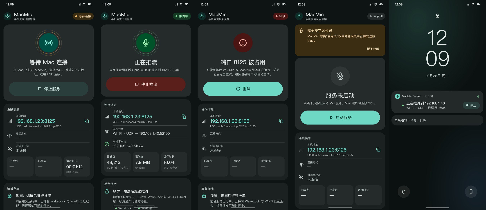
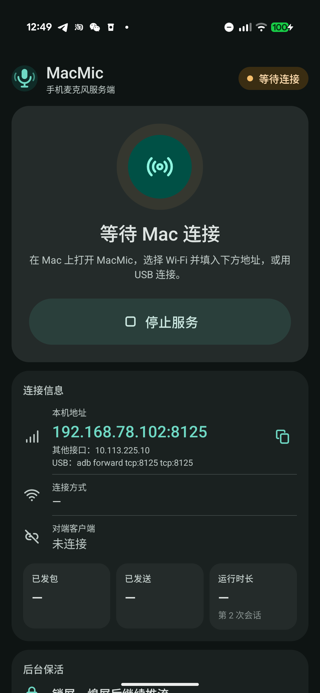
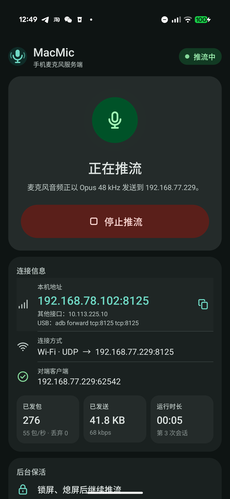

# MacMic Android（手机端）

**[MacMic](https://github.com/yudshj/MacMic)** 的手机端麦克风服务：把 Android 手机变成 Mac 的麦克风，
支持 Wi‑Fi 与 USB(ADB) 两种传输。本仓库只包含 Android 端；Mac 端在
[MacMic](https://github.com/yudshj/MacMic)。

[English](README.md)



## 背景

这个项目源于我们实际遇到的一次故障：Mac 端一直报「握手 0x65 失败」，但手机网络层完全正常 ——
同一个端口用 `nc` 起普通监听，Mac 立刻能连上；而 WO Mic 5.8（`com.wo.voice2`）的监听 socket 不回应。

我们在这台设备上的测试（WO Mic 5.8 / Android 17 / Pixel 11 Pro Fold）观察到：客户端连上但没完成握手时，
App 的会话可能一直停留在「已连接」并被占用，后续客户端被忽略，只能手动点「停止 → 开始」恢复。
**这只是我们在该版本、该设备上的实测现象，不是对该 App 的普适性判断**，其它版本/设备可能不同。

所以手机端是独立编写的，并在每条失败路径上都加了明确的超时与清理，避免一次中断就把服务卡死。

## 特性

- **与 MacMic macOS 客户端线协议兼容**：TCP 8125 控制通道，音频走 **UDP**（Wi‑Fi）或**第二条 TCP**（USB/ADB）。
- **Opus 48 kHz 单声道、20 ms 一帧、约 64 kbps VBR**，libopus 1.5.2 用 NDK 从源码编译
  （设备 vendor codec 里没有 `audio/opus` 编码器）。
- **不会卡死**：5 s 握手超时、8 s 心跳/空闲超时、失败一律 `SO_LINGER` RST 清理、acceptor 不阻塞、
  同一 IP 快速接管。
- **熄屏/锁屏继续推流**：前台服务（`microphone` 类型）+ `PARTIAL_WAKE_LOCK` + `WIFI_MODE_FULL_HIGH_PERF`。
  实测 Doze 中 60 s：49.9 包/秒、序号零丢失。
- **状态可见**：状态胶囊、对端地址、连接方式、包数/字节、运行时长、滚动事件日志 ——
  下次出问题能直接看出卡在哪。
- **无广告、无统计**，8 个权限，全部必要。

| 等待连接 | 推流中 |
| --- | --- |
|  |  |

## 要求

- 手机：**Android 10+**（`minSdk 29`），**arm64-v8a**；在 Android 17（Pixel 11 Pro Fold）上开发测试。
- Mac：macOS + [MacMic](https://github.com/yudshj/MacMic)（客户端），或任何实现了
  [协议](PROTOCOL.md)的客户端。
- 构建：**JDK 17**、Android SDK platform 36 + build-tools 36.0.0、NDK 29、CMake 3.22.1、Ninja；
  **不需要 Gradle / AGP**（见 `build.sh`）。

## 构建与安装

```bash
./build.sh                  # debug 签名 → build/MacMicServer.apk
./build.sh install          # 构建 + adb install + 授权 + 启动服务
./build.sh release          # release 签名（需要自己的 keystore）
./build.sh release-install  # release 构建 + 重装（签名不同会先卸载）+ 授权 + 启动
```

release 签名读取 `~/.android/macmic-release.properties`（`storeFile` / `storePassword` / `keyAlias` /
`keyPassword`），也可用 `MACMIC_RELEASE_KS` / `MACMIC_RELEASE_PROPERTIES` 覆盖。

首次构建会按固定 SHA-256 下载并编译 libopus 1.5.2（缓存于 `build/`，已 gitignore）。

## 使用

1. 手机打开 **MacMic** → 点 **Start**（首次授权麦克风与通知）。卡片上会显示要填进 Mac 端的地址，
   例如 `192.168.1.23:8125`。
2. Mac 端 MacMic 选 **Wi‑Fi** 填该地址；或选 **USB (ADB)**（MacMic 会自己 `adb forward`）。
3. 原版 WO Mic 不要同时运行（都占 8125）。本 App 会显示端口冲突并每 3 s 重试。

```bash
# 命令行启停（第一次可能只是把界面调到前台，再执行一次）
adb shell am start -n com.macmic.micserver/.MainActivity --ez autostart true
adb shell am start -n com.macmic.micserver/.MainActivity --ez stop true

# 从 Mac 做 socket 级端到端测试（不依赖音频库）
python3 tools/e2e_test.py wifi 192.168.1.23 10
python3 tools/e2e_test.py usb 127.0.0.1 18125 5
python3 tools/e2e_test.py silent 192.168.1.23 9   # 连上不发 0x65，应约 5 s 后被 RST
```

日志标签：`MacMicServer`。

## 协议

控制帧、11 字节媒体头、序号/时间戳、心跳与两种传输的细节见 **[PROTOCOL.md](PROTOCOL.md)**；
UI/设计系统见 [design/INTEGRATION.md](design/INTEGRATION.md)。

## 已知限制

- 只有 arm64-v8a，只在 Android 17 / Pixel 上验证过。
- 音源固定 `MIC`，手机端不做 AEC/NS（降噪在 Mac 端做），码率固定 64 kbps。
- 服务运行期间持有唤醒锁与 Wi‑Fi 锁，**不用时请停止**；建议加入电池优化白名单。
- USB 模式建媒体连接有 300 ms 探测窗口，连接后第一秒约少 35 个包。
- 未验证官方 WO Mic 桌面客户端；参考客户端是 MacMic。

## 许可

MIT，见 [LICENSE](LICENSE)。

- 本 App 是独立实现，**不含原版任何代码、素材或文案**；**与 Wolicheng Tech / WO Mic 无任何隶属、背书或赞助关系**。
  「WO Mic」是其各自权利人的商标，此处仅用于描述互操作性。
- Opus 为 BSD-3-Clause，构建时下载编译。
- 所有图标均为原创（见 [design/ICONS_LICENSE.md](design/ICONS_LICENSE.md)）。
